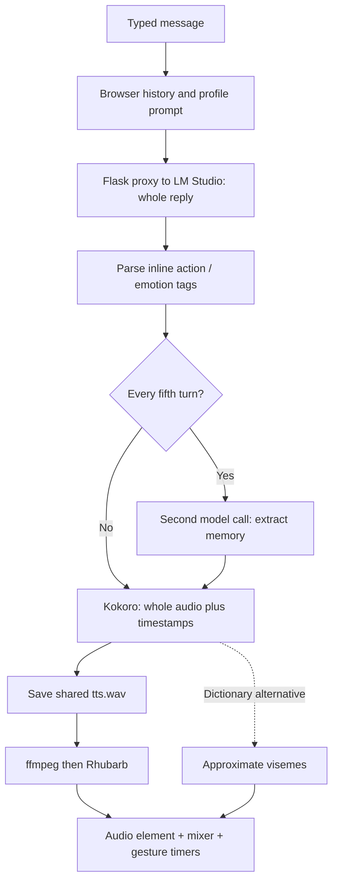
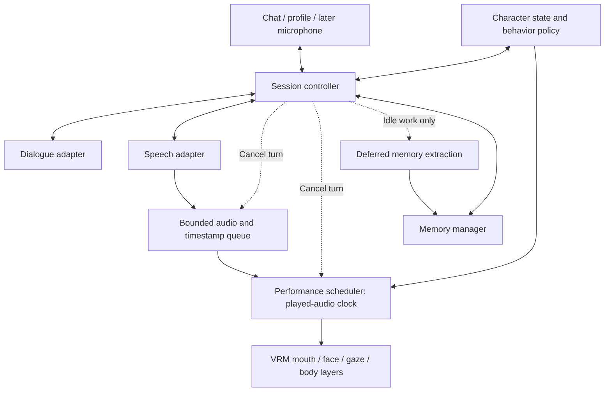

# Asena architecture health check and Ani roadmap

Audit date: 11 October 2026. Baseline: commit `51a9bd4` plus the current, uncommitted companion customization work. Implementation checklist: [TODO.md](/Users/kurciqs/Documents/coding/sayuri/asena/TODO.md).

## Verdict

**Keep Three.js / three-vrm, Kokoro, and the small local server. Strengthen the coordination between them before expanding the character.** The renderer choice fits the project's original constraints. The current app is a useful prototype, but its conversation, audio, animation, and memory lifecycles do not yet form a reliable interactive companion.

The most valuable next step is a complete, interruptible conversation turn: the UI reacts immediately, speech begins as soon as a usable segment exists, the face and body follow that speech, and cancellation stops every part of the old response. Then add consistent character state and useful memory. More gestures or a longer personality prompt alone will not address the present bottlenecks.

The original problems have mostly been reduced rather than resolved: speech still waits for the whole pipeline; action tags remain brittle; memory exists but is not updated into the active prompt; and resource use is not bounded by a low-power mode. A larger model may improve dialogue, but it will not fix these coordination problems.

## Scope and evidence

Reviewed the current frontend and Flask server, prompts, customization module, asset indexes, installation instructions, repository history, archived speech experiments, and the earlier VTube Studio / Blender prototypes. Historical context came primarily from your [Asena project note](</Users/kurciqs/Library/Mobile Documents/iCloud~md~obsidian/Documents/Vault of Apophene/code/asena.md:1>) and [VTube planning comments](/Users/kurciqs/Documents/coding/sayuri/vtube/main.py:291). Only project-relevant observations are summarized here.

Evidence labels used below:

- **Reproduced:** a defect exercised with offline fixtures or mocked services.
- **Inspected:** behavior directly evident in source, without a live end-to-end run.
- **Historical:** your earlier observation or a dated public report; not a measurement of this checkout.
- **Proposed:** an implementation choice or acceptance target.

No language model, speech generation, microphone, audio playback, Docker workload, or new inference service was run for this audit. JavaScript syntax, Python parsing, parser/animation logic with stubs, and Flask routes with mocked upstream requests were checked. These checks establish specific logic defects; they do not establish real rendering quality or live latency. Your note describes an 8 GB MacBook at the time; current hardware and peak RAM were not measured. Historical timing estimates must not be used as current benchmarks.

## How the project reached this architecture

Your goal was a private, locally controlled companion, with freedom to customize the character and relationship. The current customizable profile preserves that direction.

1. **VTube Studio / Live2D:** talking worked, but the frontal viewpoint, limited mouth motion, animation authoring restrictions, and application memory cost were frustrating. Your note estimates around 3 GB for that application, before the language model and Docker. This is a historical observation.
2. **Blender:** lip sync looked more promising, but crashes, recovery problems, and difficulty controlling animation playback made the live workflow unreliable. Rendering a complete video worked, but was too slow for conversation.
3. **Three.js / three-vrm:** chosen for a lighter live renderer, reusable VRM avatars, and compatible animations. The current model loader already combines skeletons/morphs and disposes the previous VRM. Those are useful foundations to retain.
4. **Kokoro:** selected after unsuccessful XTTS and other voice experiments. The app currently requests complete captioned speech, then optionally runs ffmpeg and Rhubarb before playing it.
5. **Streaming attempt:** Python playback worked in your notes, but the browser experiment produced noise and lacked a satisfactory live alignment path. Streaming was set aside, not completed.
6. **August 2025:** actions and setup cleanup arrived, followed by the dictionary lip-sync alternative, beta memory/context tracking, and voice selection. The history ends with the usable-prototype commit on 8 August 2025.
7. **Current working tree:** the companion editor now supports name, personality, preferred user name, relationship notes, limits, and friendly / affectionate / intimate modes. This is prompt customization; it is not yet a persistent character-state or relationship system.

The early prototype's comment that Ani uses prerecorded motions is your working hypothesis, not verified information about xAI's implementation. It remains a sensible design option for Asena.

### Recovered historical backlog

Sources: the project note is undated; repository dates below come from Git. “Partial” means the prototype exists but the original goal is not fully met. Task numbers refer to the implementation checklist.

| ID | Earlier goal or flaw | Evidence | Current status | Follow-through |
| --- | --- | --- | --- | --- |
| H01 | Stream Kokoro instead of waiting for a full response | Note line 18; VTube line 300; README at `5cc6db3` (31 Jul 2025) | Open. Current request uses `stream: false`. Browser experiment is archived. | Tasks 11–14 |
| H02 | Fast, convincing lip sync without a long Rhubarb wait | README at `5cc6db3`; dictionary added at `a158557` (1 Aug) | Partial. Two paths exist, but Rhubarb blocks playback and dictionary timing is approximate. | Tasks 05, 14 |
| H03 | Correct, varied, context-appropriate actions and emotions | Note line 19; current README lines 21–25; early README TODO | Partial. Tags work for some inputs; selection and alignment remain unreliable. | Tasks 04, 19–21 |
| H04 | Summaries / memories stored in a file and reused | VTube line 297; README history; `7cb2ae0` (4 Aug) | Partial. Extraction appends strings, persistence is manual, and the active memory prompt stays stale. | Tasks 24–28 |
| H05 | Stress-test memory | Note line 20 | Not evidenced as completed. No existing automated suite found. | Task 38 |
| H06 | Try a better LLM / improve prompting | README at `5cc6db3`; current README | Open evaluation. Model name is hardcoded; no repeatable comparison set. | Tasks 17, 38 |
| H07 | Speech-friendly output and a stronger character prompt | VTube line 297; README history | Partial. Prompt improved and profile customization added; voice delivery is still separate and fixed. | Tasks 17, 22 |
| H08 | UI cleanup and web features | Initial README; checked off in later README | Basic prototype achieved. Error, progress, interruption, microphone, and session controls remain. | Tasks 01, 02, 29–30 |
| H09 | Cleaner installation | README at `0c76cd0`; later installation commits | Partial. Guide exists, but dependencies/assets are not reproducible and parts contradict current code. | Tasks 09, 31 |
| H10 | More animations, including untrimmed Mixamo clips | README at `0c76cd0` (3 Aug) | Local collection exists: all 14 indexed animation files were present. Most assets are ignored by Git. | Tasks 03, 09, 20 |
| H11 | Avoid blinking conflicts with closed-eye expressions | Current `animation.js` TODO | Open. Only a special happy-expression check exists; blinking is frame-based. | Task 21 |
| H12 | Make Unity `.anim` → generic FBX conversion manageable | Note lines 11–16 | Workflow documented, not automated in this repository. | Tasks 09, 20 |
| H13 | Supply clearer Mixamo download guidance | README asset section / older pending links | Open. Exact asset names, source links, and setup validation are needed. | Task 09 |
| H14 | Reduce laptop load or move processing to a stronger desktop | Note; README; `server.py` line 17 | Backend addresses can be edited manually. No resource policy or verified deployment profile. | Tasks 10, 16, 31 |

Returning to VTube Studio or offline Blender rendering would reopen constraints you already encountered. Reconsider either only if a concrete missing capability makes the tradeoff worthwhile.

## Current architecture

`main.js` owns networking, conversation history, memory, timing conversion, and much of the UI. `animation.js` owns rendering, assets, expressions, blinking, and playback. Flask is mostly a proxy and shared-file bridge. The main weakness is ownership: no component owns one conversation turn from request through playback completion and cancellation.

### Findings and improvements

Priority meanings: **P0** = stabilize before expansion; **P1** = responsiveness; **P2** = character realism; **P3** = continuity / memory. Privacy containment is a confirmed local design flaw and becomes especially important before using a LAN-hosted desktop.

| Finding | Evidence and practical effect | Recommendation |
| --- | --- | --- |
| **P0 — Playback has no turn lifecycle** | **Reproduced / inspected.** `talk()` pauses the incoming audio rather than the previous one. The browser unlocks while playback continues. Old gesture timers cannot be cancelled. [Audio handling](/Users/kurciqs/Documents/coding/sayuri/asena/src/animation.js:300), [turn unlock](/Users/kurciqs/Documents/coding/sayuri/asena/src/main.js:353). | One active turn ID, owned audio queue, abort controller, and stop/pause/resume semantics. Reject late results from cancelled turns. Task 02. |
| **P0 — Animation readiness is premature** | **Inspected.** Async `forEach` is not awaited; `animationsLoaded` becomes true before clips finish. Ten-millisecond polling can continue forever after a failed load. Repeated loads add listeners. Model changes have no generation guard. [Loader](/Users/kurciqs/Documents/coding/sayuri/asena/src/animation.js:90). | Await bounded asset promises; idle-first readiness; per-model load generation; degraded mode and missing-asset fallback. Task 03. |
| **P0 — Missing animations can throw** | **Reproduced.** A missing clip reaches `.reset()` on `undefined`; this contradicts README's “ignore missing animations” claim. Idle/current actions are also assumed present. [Playback](/Users/kurciqs/Documents/coding/sayuri/asena/src/animation.js:230). | Validate against available actions, default to idle/no gesture, and keep ordinary conversation usable. Tasks 03–04. |
| **P0 — Tags can alter speech and lose timing** | **Reproduced.** `I *really* liked that.` becomes `I liked that.` Unknown starred content is discarded. `*sighs*` resolves only to an action because a duplicate key overwrites the emotion. Trailing gestures can disappear; whitespace normalization changes saved offsets. [Parser](/Users/kurciqs/Documents/coding/sayuri/asena/src/emotion_classifier.js:24), [alignment](/Users/kurciqs/Documents/coding/sayuri/asena/src/emotion_classifier.js:137). | Separate spoken text from structured performance events. In a compatibility parser, recognize only explicit known directions and align against normalized spoken tokens. Task 04. |
| **P0 — Mouth / expression tracks are fragile** | **Reproduced / inspected.** Several Rhubarb codes produce tracks for the same VRM property, e.g. three `aa` tracks. Metadata is logged but not awaited; `audio.duration` can be `NaN`. Emotion keys can begin at negative times. Actual visual impact was not benchmarked. [Track creation](/Users/kurciqs/Documents/coding/sayuri/asena/src/animation.js:322), [duration](/Users/kurciqs/Documents/coding/sayuri/asena/src/main.js:349). | Merge cues by VRM channel, validate finite monotonic timing, resolve expression bindings once, await playable audio, and handle rejected playback. Task 05. |
| **P0 — Service errors are obscured** | **Reproduced / inspected.** Mock upstream HTTP 500 is returned as HTTP 200 by `/chat` and `/tts`. Requests and subprocesses have no timeout. `/get_visemes` with `{}` gives 500. UI failures generally go only to the console. [Proxy](/Users/kurciqs/Documents/coding/sayuri/asena/server.py:28), [visemes](/Users/kurciqs/Documents/coding/sayuri/asena/server.py:95), [UI](/Users/kurciqs/Documents/coding/sayuri/asena/src/main.js:354). | Typed errors, status propagation, deadlines, payload checks, service-offline state, and text-only / approximate-mouth fallback. Task 06. |
| **P0 — User data and writes need containment** | **Reproduced / inspected.** Concatenated client filenames permit traversal outside the save directory. The reproduction wrote only inside a disposable temporary directory. Memory/audio are beneath the static root; `/data/memory.json` is retrievable. CORS permits arbitrary origins. [Writes](/Users/kurciqs/Documents/coding/sayuri/asena/server.py:54), [static routes](/Users/kurciqs/Documents/coding/sayuri/asena/server.py:21). | Server-selected data paths outside static assets, fixed resource IDs, bounded validated requests, atomic writes, same-origin access by default, and authentication before remote access. Task 07. |
| **P0 — Context has no budget management** | **Inspected.** History and memories grow without trimming. The denominator is fixed at 4,000 rather than configured model capacity; the memory-extraction call overwrites the displayed token usage. Profile fields can consume substantial context. [Chat usage](/Users/kurciqs/Documents/coding/sayuri/asena/src/main.js:136), [profile lengths](/Users/kurciqs/Documents/coding/sayuri/asena/src/companion.js:31). | Reserve reply space, retain recent turns, select bounded memories, and track main dialogue usage separately. Task 08. |
| **P0 — Installation and asset baseline can drift** | **Inspected.** No dependency manifest / lockfile or existing test suite found. `three-vrm@3` floats; ignored local animations are still listed as required. Installation says the LLM does not control animations, although it does. [Imports](/Users/kurciqs/Documents/coding/sayuri/asena/src/index.html:81), [guide](/Users/kurciqs/Documents/coding/sayuri/asena/INSTALLATION.md:20), [ignored assets](/Users/kurciqs/Documents/coding/sayuri/asena/.gitignore:3). | Pin dependencies, centralize endpoint/model/path settings, document exact assets and conversion steps, and provide a fixture-only setup path. Task 09. |
| **P0 — Startup and rendering lack a low-power path** | **Inspected.** A roughly 10 MB dictionary is fetched even in Rhubarb mode; data fetch failures can prevent UI setup. WebGL initializes during module import. Full device pixel ratio, shadows, disabled culling, per-frame resize, and continuous background rendering are potential costs, not measured RAM figures. [Startup](/Users/kurciqs/Documents/coding/sayuri/asena/src/main.js:14), [renderer](/Users/kurciqs/Documents/coding/sayuri/asena/src/animation.js:39), [frame loop](/Users/kurciqs/Documents/coding/sayuri/asena/src/animation.js:257). | Independent UI bootstrap, lazy assets/dictionary, capped resolution, optional shadows, resize-on-change, background throttling, and text-only mode. Task 10. |
| **P1 — Speech waits for all preparation** | **Inspected.** Full LLM reply → occasional second LLM call → full TTS → shared file → ffmpeg → Rhubarb. A Rhubarb error stops the voice response. Blob URLs are never revoked. [Response pipeline](/Users/kurciqs/Documents/coding/sayuri/asena/src/main.js:303). | Start with one bounded speech segment; stream when the installed backend supports it; use an audio-clock queue and online mouth fallback. Tasks 11–15. |
| **P2 — Personality only influences the prompt** | **Inspected.** Customization is saved and applied, but does not own mood, gaze, gesture frequency, voice delivery, appearance, or relationship continuity. [Profile](/Users/kurciqs/Documents/coding/sayuri/asena/src/companion.js:58). | Stable editable persona plus small explicit state and a bounded behavior policy. Keep chosen closeness separate from familiarity. Tasks 17–23. |
| **P3 — New memories do not reach the current conversation** | **Inspected.** Memory prompt is constructed once at startup. Every fifth turn appends extracted strings to another array; only manual save persists them, with no response check. Conversation history is not saved. [Initialization](/Users/kurciqs/Documents/coding/sayuri/asena/src/main.js:111), [extraction](/Users/kurciqs/Documents/coding/sayuri/asena/src/main.js:310), [save](/Users/kurciqs/Documents/coding/sayuri/asena/src/main.js:426). | Update active retrieval immediately, persist reliably, and defer extraction until foreground work is finished. Tasks 25–27. |
| **P3 — Memory quality is unconstrained** | **Inspected.** A companion-persona call summarizes the entire copied history despite asking for the last five responses. “Character behavior” can enter the same string list as user facts. No source, correction, deduplication, confidence, or retrieval budget. | Store evidenced facts separately from fictional character background and inferred observations; support correction/forgetting. Tasks 24, 26, 28. |

The unused keyword classifier is not a convincing replacement for model-selected behavior: it uses substring matches and first-match priority, without negation or conversational context. Use deterministic code to constrain and schedule behavior; use the dialogue model to propose meaning when it can do so reliably.

### Offline reproduction record

| Check | Result |
| --- | --- |
| All current frontend JavaScript files: syntax check; server: Python AST parse | Passed. Syntax validity is not end-to-end correctness. |
| Model / animation index entries resolved locally | All listed assets existed in this checkout, including 14 animations. Fresh-clone completeness is separate. |
| `decodeTaggedMessage("I *really* liked that.")` | Returned `I liked that.` |
| `*sighs*` classification | Zero emotions; one `sigh` action. |
| `Hi. *waves*` aligned against the spoken word | Returned no action. |
| `Hello  *nods* there.` | Saved action offset 7; normalized `there` begins at 6. |
| Request missing animation with stubbed mixer/actions | Threw on an undefined action's `reset`. |
| Two `talk()` calls with stubbed audio | First audio was paused only during its own initialization, never when the second began. |
| Stubbed mouth-track creation | Duplicate expression target names; non-finite clip duration when metadata duration was `NaN`. |
| Flask `/chat` and `/tts` with mock HTTP 500 responses | Both returned HTTP 200. No real upstream request. |
| Flask `/get_visemes` with empty JSON | HTTP 500. No ffmpeg/Rhubarb workload. |
| Flask `/save_json`, temporary save root and filename `/../escaped.json` | Escaped the configured root into the disposable parent directory. No existing project data changed. |
| Static memory route / arbitrary-origin request | Memory route returned 200; permissive CORS response observed. Memory contents were not reproduced in this report. |

The fixture checks used real parsing logic and selected animation functions with stubs. They did not instantiate a real renderer or play sound. No permanent test harness was added during this read-only audit.

## What to reproduce from Grok Ani

Treat Ani as an experience reference: a character with a visible body, recognizable personality, expressive speech, and a sense of interaction. Public evidence is much stronger for those observable qualities than for its internal implementation.

The July 2025 firsthand [Tom's Guide trial](https://www.tomsguide.com/ai/i-tried-groks-new-companion-feature-and-ive-never-felt-so-uncomfortable) describes voice/text conversation, an affectionate and flirtatious persona, expressive voice, spinning/dancing, a black dress, and background jazz. Your README's [original Reddit reference](https://www.reddit.com/r/grok/comments/1m7yg3o/just_tried_groks_new_ai_companion_ani_its_kinda/) additionally reports relationship levels, hearts/glow, recording, multilingual conversation, and requested personality changes. The post's outfit-unlock claim is hearsay within that user account, rather than a verified specification.

These are historical observations of the 2025 experience. The official FAQ, updated 6 October 2026, currently describes Companions as iOS-only; it does not document Ani's control protocol or relationship formula. [Official FAQ](https://docs.x.ai/grok/faq)

| Experience target | Evidence confidence | Asena gap / implementation direction |
| --- | --- | --- |
| Voice conversation with a visible character | Firsthand 2025 review | Currently typed input and generated speech output. Add microphone input and interruption after playback is reliable. |
| Goth / anime presentation and intentional body performance | Firsthand 2025 review / original user report | VRM foundation exists. Improve pose, camera, lighting, motion transitions, and a small authored gesture repertoire. |
| Strong, playful, affectionate character identity | Firsthand 2025 review | Editable persona exists. Add authored dialogue examples, stable fictional interests, contextual tone, and reduced repetitive stock phrasing. |
| Voice conveys the same attitude as the dialogue | Firsthand 2025 review | Current TTS receives text, selected voice, and fixed speed. Introduce capability-aware delivery controls; evaluate contextual speech later. |
| Familiarity levels, hearts and visual reactions | Anecdotal original user report | No relationship-state UI. Optional progression and reaction effects can be added after continuity works. |
| Outfit variation / more intimate presentation | Historical user reports; exact rules unverified | Avatar selection exists; a curated appearance system does not. Make appearance and closeness user-controlled, with optional progression separate. |
| Personality changes and multiple languages | Anecdotal original user report | Profile editing works. English dictionary alignment will need replacement or language-specific handling before multilingual speech is convincing. |
| Save a clip of the character | Anecdotal original user report | Future recording/export, after synchronization and data controls. Task 32 includes this optional polish. |

**Not established by this research:** Ani's exact model, engine, animation assets, live speech architecture, private memory design, current outfit thresholds, or exact affinity formula. No official Ani source code or authenticated full character prompt was identified. The proposed Ani prompt in [xAI repository PR #72](https://github.com/xai-org/grok-prompts/pull/72) is an open community contribution with no reviews, not an official published implementation. It can be a curiosity, but should not become Asena's specification.

My recommendation is an Ani-like adult companion preset within the customizable system. Match the deliberate presentation and social responsiveness, then let the user set personality and intimacy. Familiarity can grow through remembered interactions while chosen closeness stays an explicit preference. This fits your goal better than making every character use one fixed flirtatious script.

## Strategies for a more believable character

The following are design recommendations adapted to Asena. The cited work provides useful mechanisms and evaluation ideas; it does not prove that a particular combination will reproduce Ani.

### 1. Coordinate speech and movement as one performance

SmartBody's architecture uses connected controllers to schedule and combine animation methods. Borrow that pattern: separate idle posture, gaze, facial expression, mouth movement, and intentional gestures, then give them a common turn owner and playback timeline. This can be implemented within three-vrm. [SmartBody, authors' institutional abstract, 2008](https://vgl.ict.usc.edu/bibtexbrowser.php?bib=ICT.bib&key=thiebaux_smartbody%3A_2008)

For Asena, mouth motion should follow played audio time; head movement should support emphasis or attention; larger gestures should occur selectively. Use upper-body masks / additive layers where appropriate, with a clear rule for full-body clips and root motion. A small repertoire of well-timed motions is likely more useful than many interchangeable full-body animations. That is a design hypothesis to test with replay scenes.

Give each segment spoken text and validated events anchored to words or segment boundaries. Resolve those anchors using speech timestamps. Unknown events degrade to neutral behavior. The dialogue model should never supply arbitrary file paths or direct animation code.

### 2. Restore streaming with a verified backend contract

Current Kokoro-FastAPI documentation describes `/dev/captioned_speech` streaming JSON lines containing audio and word timestamps. The `/v1/audio/speech` timing sidecar is available after generation and gives chunk-level timing. Phonemization alone does not provide phoneme durations. Smaller synthesis chunks can harm intonation. The installed version has not been checked; pin and validate the contract first. [Upstream Kokoro README](https://github.com/remsky/Kokoro-FastAPI/blob/master/README.md)

Your [archived PCM experiment](</Users/kurciqs/Documents/coding/sayuri/asena/archive/main (dict).js:218>) has plausible causes for the noise: discarded odd bytes, typed-array views that ignore the returned slice's offset/length, and immediate playback of every chunk, which can overlap. This is a source-based diagnosis, not a reproduction of the old recording. Browser streaming is feasible: Web Audio schedules source starts against `AudioContext.currentTime`. First establish byte framing, sample format, and a bounded queue with synthetic fixtures. [MDN scheduling](https://developer.mozilla.org/en-US/docs/Web/API/AudioBufferSourceNode/start), [MDN audio clock](https://developer.mozilla.org/en-US/docs/Web/API/BaseAudioContext/currentTime)

On the constrained laptop, begin with a short complete text reply followed by streaming speech. Overlap language generation and synthesis only on a deployment whose memory budget has been checked. Streaming network output does not by itself reduce the resident memory of two loaded models. Keep Rhubarb as an optional quality / offline path; compare online timestamp-driven approximation against it rather than promising exact phoneme alignment.

### 3. Separate personality, mood, and momentary reactions

ALMA distinguishes short-lived emotion, medium-term mood, and long-term personality. Use that separation in a lightweight state object, with decay and rate-limited transitions; do not make another model run continuously. [ALMA, Patrick Gebhard, 2005, author-uploaded paper](https://www.researchgate.net/publication/221455945_ALMA_a_layered_model_of_affect)

Suggested state: current interaction phase, mood valence/arousal, transient reaction, current conversational goal, recently used gestures, and familiarity. Stable traits and fictional biography come from the editable profile. Listening, thinking, speaking, and interrupted states drive animation immediately. A disappointed sentence should not instantly replace a longstanding personality; an amused sentence should not trigger a full-body dance every time.

The character needs specific interests, opinions, humor, and a few recognizable habits. Author example exchanges for teasing, disagreement, comfort, ordinary small talk, and affectionate conversation. Let response length vary with the moment. Track repeated openers, pet names, and questions so warmth does not collapse into the same three phrases.

### 4. Constrain behavior without making it mechanical

LM Studio supports JSON-schema responses, with model/backend compatibility caveats. A small schema can constrain gesture names, intensity, and speech fields. This addresses invented labels; it does not ensure that a valid gesture fits the situation. [LM Studio structured output](https://lmstudio.ai/docs/developer/openai-compat/structured-output)

Use one dialogue call that proposes speech and a few high-level cues. A deterministic character controller enforces availability, cooldowns, intensity limits, and valid transitions. Prefer no gesture when uncertain. Keep format validation separate from social-quality evaluation. Avoid adding an always-on emotion classifier model to a memory-constrained machine.

A whole-response JSON object can postpone speech until parsing finishes. If text generation is streamed later, design independently complete segment records or another validated framing protocol; do not assume adding `stream: true` makes a JSON performance plan incrementally usable.

### 5. Make continuity grounded and revisable

Generative Agents combines recorded observations, retrieval, reflection, and planning; its ablations found these components contributed to believability in its simulated environment. Adapt the memory/retrieval pattern at much smaller scale. [Park et al., 2023](https://arxiv.org/abs/2304.03442)

Start with explicit user facts, preferences, shared conversation events, and unresolved topics. Each record needs a source turn, date, kind, and correction status. Store character fiction separately. Retrieve only relevant items within a token budget. Keep recent dialogue verbatim and summarize older dialogue only when needed. Extraction should run after foreground work, with a dedicated factual instruction rather than the companion's persona, and may be postponed entirely on a busy machine.

Long-term believability must be tested across sessions: LIFELONG-SOTOPIA reports deterioration over repeated interactions in its evaluated agents, with improved memory helping but not closing the gap. A saved summary is not sufficient evidence of continuity. [Goel and Zhu, 2025](https://arxiv.org/abs/2506.12666)

Example checks: the character remembers an explicitly stated preference, accepts its correction, notices an unfinished topic later, and does not present roleplayed events as real memories. Current wishes and profile changes should take precedence over older information.

### 6. Treat voice delivery as a distinct capability

Sesame's research emphasizes emotional context, conversational timing, contextual tone, and consistent personality. It also distinguishes natural-sounding speech from speech that is appropriate to the preceding conversation. This is particularly relevant to an affectionate or intimate companion. [Sesame conversational voice research, February 2025](https://www.sesame.com/journal/crossing-the-uncanny-valley-of-voice)

Current Asena gives TTS cleaned text, a voice ID, and speed 1.0; the facial emotion tag never reaches the synthesizer as an emotional instruction. Prompt changes can improve wording, but cannot guarantee a tender, amused, or hesitant delivery. Add voice settings and supported pacing/pause controls first. Evaluate an expressive or context-aware speech backend as a separate, resource-budgeted experiment later. Avoid random filler, breath sounds, or constant whispering: use them only if they fit the character and scene.

### 7. Add natural turn-taking after interruption works

TurnBench distinguishes real turn ends, mid-turn pauses, interruptions, and acknowledgments that do not claim the floor. Its 2026 analysis highlights a speed/accuracy tradeoff. This provides a useful evaluation framework for eventual voice conversation. [Sesame TurnBench, August 2026](https://www.sesame.com/journal/turnbench)

Begin with push-to-talk and a visible stop button. Then add echo-aware voice activity detection, transcription, and deliberate interruption handling. A simple silence threshold should not be the final definition of “the user finished.” Smart Turn is one later candidate for semantic end-of-turn detection, subject to its own compute budget. [Pipecat Smart Turn](https://github.com/pipecat-ai/smart-turn)

Do not stop every response merely because the microphone hears “mm-hmm.” Listening gaze, a small acknowledgment, and yielding the floor should be separate behaviors. Test the policy with recorded fixtures before introducing another resident model.

### 8. Measure whether the character feels coherent

SOTOPIA evaluates language agents through social scenarios. Adapt that scenario approach into a small companion rubric, with user ratings rather than relying solely on another model's judgment. [SOTOPIA, 2023](https://arxiv.org/abs/2310.11667)

Use the same scenes for each change: greeting after a break; a joke; disagreement; a factual preference and correction; comforting conversation; affectionate exchange; requested reduction in closeness; interruption; unknown animation; and a long session. Score response specificity, persona consistency, memory accuracy, repetition, fitting emotion, timing, and audiovisual agreement. Model comparisons should use identical examples and one loaded candidate at a time.

## Recommended boundaries and flow

Keep the current languages/frameworks initially. Extract ownership gradually rather than introduce a large rewrite.

| Component | Owns |
| --- | --- |
| Session controller | Turn IDs, state transitions, cancellation, progress, active playback, late-result rejection |
| Dialogue adapter | Endpoint/model configuration, response framing, text streaming, request errors |
| Speech adapter | Backend capability checks, audio/timestamp chunks, pronunciation and delivery settings |
| Performance scheduler | Played-audio clock, mouth/face/gaze/body layers, pause/stop and event cleanup |
| Character state / policy | Editable stable persona, mood and attention, gesture selection constraints, optional familiarity |
| Memory manager | Source-backed records, retrieval budgets, corrections, persistence, deferred extraction |
| Flask data/service layer | Validated proxy contracts, private storage, deadlines, per-turn resources, access boundaries |

No permanent bidirectional transport is necessary for the first streaming output milestone: a streamed HTTP response and ordinary cancellation can suffice. Choose a WebSocket or another event transport when microphone streaming and richer bidirectional events actually require it.

### Resource discipline

- Default development mode should use recorded or synthetic responses. Opening the website should never start/download models. Keep text-only operation available when speech or WebGL is unavailable.
- Serialize expensive work by default on the constrained laptop. Do not run memory extraction alongside language generation or TTS. Cap text length, audio buffering, queues, history, and retained objects.
- Make renderer quality selectable; prioritize idle/essential assets and suspend or throttle background rendering. Measure rather than assume that disk asset size equals RAM use.
- For an Apple Silicon deployment, upstream Kokoro documents native MPS outside Docker; its CUDA image cannot use Apple's GPU. This is a candidate configuration, not a verified speedup here. [Kokoro setup](https://github.com/remsky/Kokoro-FastAPI/blob/master/README.md)
- A stronger desktop on the same network remains compatible with the original goal, after data storage/access is corrected. Local inference and fully offline operation are separate: the frontend currently fetches CDN dependencies and external fonts. Vendor assets if offline use is required.
- Live benchmarking is a separate, explicitly agreed step: one short request, one configuration, observed memory pressure, and a clear stop condition. This audit intentionally provides no live model/TTS performance claim.

## Implementation order and first milestone

1. **Reliable prototype:** offline replay, turn cancellation, asset readiness, parser/track correctness, error handling, contained storage, context limits, setup and low-power mode. Tasks 01–10.
2. **Responsive performance:** one audio clock, bounded queue, verified captioned streaming, speech segmentation, online lip sync, and resource cleanup. Tasks 11–16. Update memory injection / extraction timing from task 25 early, too.
3. **Character coherence:** persona examples, layered state, constrained cues, blended gestures, responsive gaze/blink, and voice delivery. Tasks 17–23.
4. **Persistent continuity:** structured memory, retrieval, conversation persistence, and correction/export controls. Tasks 24–28; this can proceed alongside character work after P0.
5. **Spoken interaction:** push-to-talk first, then selective interruption and semantic turn-taking. Tasks 29–31.
6. **Ani presentation polish:** curated looks, scenes, optional reaction/progression effects, recording, routines, and multilingual support. Tasks 32–36.

Create the reference scenes and rubric in task 37 at the start; use task 38 throughout for session regression and, only when authorized, model comparison.

**First milestone:** with fixture responses, the character moves through idle → thinking → speaking, synchronizes face/gesture with a short audio segment, stops all old output on interruption, survives missing assets/services, and retains the selected profile plus an explicitly saved conversation fact after reload. Only then verify the same path with a short live request when the machine is ready.

Suggested acceptance targets are provisional: cancellation within 150 ms in local replay; no events firing after cancellation; no audible overlap; bounded retained objects across repeated turns. A later first-audio target below two seconds is aspirational and deployment-dependent, not a promise for the historically described 8 GB machine. Measure median and slow-tail latency, distinguishing first text, first playable audio, final audio, and extraction work.

This preserves the strongest part of the original design—a lightweight, customizable local character—while addressing the unfinished work that currently limits presence and realism.
