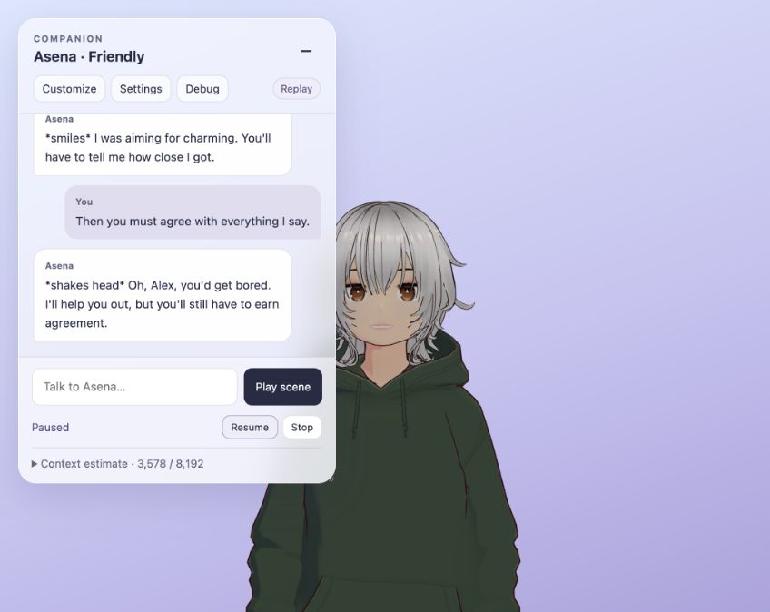

# TODO 11 — Audio-clock performance scheduler

Implemented 11 October 2026. Speech-linked mouth motion, emotion and body gestures now sample **the current audio playback position**. Pausing or starving the audio no longer lets gesture timers or the facial mixer run ahead. Idle movement, blinking, gaze and spring physics retain their independent presentation time.

## Behavior

Each prepared speech segment contains finite-duration audio, visemes, emotions and gesture anchors. The scheduler owns playback and completion, media listeners, cancellation, the segment queue and its progress deadline. The current complete-reply path uses one segment through this same queue.

The renderer samples `audio.currentTime` and applies facial tracks at that position. Body fades are precomputed from their audio anchors; interrupted transitions retain total weight one when an idle clip is available. A skipped frame can seek directly to the current pose instead of firing a backlog of old gesture timers. When a segment finishes or is stopped, facial channels close and the body blends back to idle.

The new **Pause / Resume** control appears during playback. Stop remains available while paused. A pause freezes the speech timeline and excludes that time from failure detection. An actual stall keeps the same speech pose and reports “Waiting for audio”; eight seconds without playback progress fails with a retryable message. Progress resets the deadline, so a healthy long recording is not limited by a duration-plus-eight-second wall timer. An unfinished producer gap is also bounded to eight seconds, excluding a user pause.

The inspector's `animation.scheduler` branch exposes phase, local segment time, total played seconds, queue depth, queued duration, pause state, acceptance state, limits and error. Applied mouth measurements and body weights remain available beside it. Animation preview is disabled during speech to keep the performance's body owner unambiguous.

## Queue and future streaming interface

`AvatarClient` exposes `beginPerformance({signal})`, `enqueuePerformanceSegment(record)`, and `finishPerformance()`, plus pause/resume/stop. Begin returns a promise that settles when the closed queue finishes, fails or is cancelled. Enqueue accepts only a complete, prepared record; the producer must await `preparePerformance(actions, signal)` for its gestures first. Finish marks the end of input, not the end of current playback.

The default limits are:

| Limit | Bound |
| --- | ---: |
| Active plus queued segments | 4 |
| Active plus queued audio duration | 180 seconds |
| Total accepted audio per turn | 600 seconds |
| Accepted segments per turn | 256 |
| Cues per channel per segment | 4,096 |
| No-progress / producer-gap deadline | 8 seconds |

Exceeding capacity throws an explicit queue-full error. A future producer must wait for capacity before trying again; this implementation does not silently accept or drop overflow. Cue records are copied at admission. Completed audio instances are tracked weakly, so duplicate detection does not retain all past recordings. Each segment uses a distinct audio instance. The preceding media is paused and its listeners removed before the next segment starts. Cancellation clears queued work, detaches listeners and ignores stale playback promises/events. An optional record `release()` callback runs when its ownership ends; existing turn-owned Blob URL cleanup remains active.

These are sequential HTML audio segments. Small browser-dependent gaps at boundaries remain possible. This does not promise sample-accurate gapless audio, fetch live Kokoro chunks, split text, or change Rhubarb analysis. Those belong to TODOs 12–14. Hidden tabs continue audio and queue advancement while drawing remains stopped; showing the tab seeks the performance to current audio time.

## Verification

The complete suite passes **68 tests: 49 JavaScript and 19 Python**. Ten new scheduler regressions cover:

- Real Three.js bone poses and VRM morph bindings during pause, stalls, resume and cleanup, including a two-minute simulated pause.
- Skipped frames, direct seeking and interrupted body fades without a rest-pose weight gap.
- Sequential segments, independent copied cue records, actual expression/body transitions at a segment boundary, and final closure.
- Queue/duration bounds, duplicate audio, invalid timing and unbounded metadata rejection.
- Abort, discarded queued segments, delayed playback promises and stale media events.
- Progress-based deadlines, excluded pause time, paused boundaries and producer gaps.
- Playback rejection, expression preparation failure and cleanup errors settling the turn.

Existing speech integration tests now execute the production scheduler and visual driver with controlled IO, rather than advancing a separate mixer after playback. Missing mouth bindings still preserve audio and report a neutral facial fallback.

Browser replay checks covered introduction, teasing and disagreement playback, long pause/resume, frozen nod timing and body weights, Stop while paused, and subsequent playback. The disagreement recording reached applied mouth morph weight **0.999**, ended with mouth weight **0** and idle body weight **1**. While the emote recording was paused, audio time stayed **0.039568 seconds** and the idle/nod weights stayed **0.921 / 0.079** across repeated inspection. A browser timer-cleanup failure discovered during development was repaired; the subsequent recording reached “Finished” after its long pause. Console checks found no warnings or errors in the repaired playback.

The [paused inspector screenshot](evidence/todo11-paused.jpg) records the audio clock and body weights alongside the controls.

Only saved recordings, mock media and existing small animation libraries were used. No LLM, Kokoro, Docker workload or Rhubarb process was started. Timing precision on a busy laptop and live streaming still require their later prepared tests. The happy-mouth stretching issue remains tracked under TODO 20a.

## Try it

Refresh the replay website, play a scene, then use Pause/Resume and Stop. Open Debug → Inspect this turn → animation → scheduler to watch the audio clock. During a pause its speech time and gesture weights should hold; blinking and idle motion can continue. After completion, mouth channels should close and the character should return to idle.
