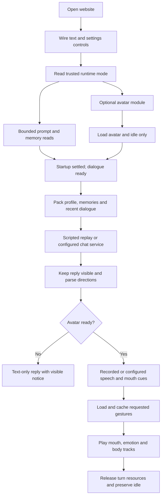
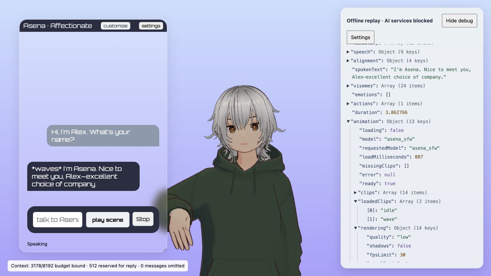
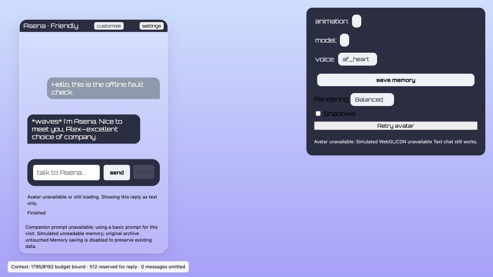

# Asena: implementation report for TODOs 02–10

**Date:** 11 October 2026. **Branch:** `codex/stabilize-todos-02-09` (the existing branch now also includes TODO 10).

## What is ready for review

The current companion loop has explicit turn ownership, bounded failures, corrected parsing and expression binding, private memory/audio storage, bounded conversation input, reproducible configuration, and independent UI/renderer startup. TODO 10 adds lower-power rendering and loads gestures only when needed. The editable personality and chosen closeness still feed the next dialogue prompt; the existing string-list memory format and manual Save workflow remain.

The subsequent [TODO 10a UI cleanup](ui-cleanup-10a.md) documents the chosen draggable-chat/shared-tools layout, context breakdown, screenshots and Jakub's manual acceptance on 11 October 2026. Its additional context diagnostic regression brings the current suite to 58 passing checks; the 57-test counts below record the preceding review fixes.

The later [TODO 11 audio-clock scheduler](audio-clock-11.md) replaces independent speech clocks, adds Pause/Resume and a bounded segment queue, and brings the current suite to 68 passing checks. Timing limitations below describe the earlier 02–10 implementation.

Implementation and offline verification are complete for this slice. Jakub's visual acceptance remains pending. This report does **not** establish live Qwen dialogue quality, live memory-extraction quality, natural motion, exact speech synchronization, battery savings, or acceptable combined LLM/TTS memory pressure. Those require their own evaluation. The earlier lip-sync/T-pose regression is included below because it exposed a significant gap in the original verification.

No LLM, Kokoro, Docker workload, or alignment process was started for TODOs 02–10 or their rendering fix. Verification used existing recordings, mock service responses, the real animation libraries, and the browser. Small pinned JavaScript test dependencies were installed; that is separate from downloading or running an AI model.

## Commit trail

Each original TODO has its own commit. The rendering repair has an additional commit rather than rewriting the earlier work.

| Item | Commit | Main outcome |
| --- | --- | --- |
| Baseline / TODO 01 context | `dcc3993` | Preserved personality customization, saved replay material, inspector and backlog |
| 02 | `063dd80` | Owned turn lifecycle, cancellation and stale-result guards |
| 03 | `141a887` | Bounded asset loading and guarded avatar replacement |
| 04 | `10fbfb9` | Preserved speech text and normalized cue anchors |
| 05 | `bb26347` | Merged expression channels and awaited usable audio metadata |
| 06 | `ee048da` | Bounded service failures, retained replies and speech retry |
| 07 | `56d6232` | Private memory and server-owned temporary audio resources |
| 08 | `5917a0d` | Bounded dialogue/profile/memory input and visible budget meter |
| 09 | `900c7e4` | Pinned dependencies and documented safe setup |
| Rendering follow-up | `7ee1bf4` | Correct VRM keys, continuous idle and real animation tests |
| 10 | `804e22d` | Independent startup, lazy gestures and rendering profiles |

The original slice was subsequently pushed to GitHub on this branch. Ignored personal memories, generated audio and local FBX files are outside the commit trail; they need their own backup. Existing Git history was retained.

## Current flow

The browser never chooses live mode as a fallback for a broken replay/configuration response. Opening the website still does not start backend models. In live mode, sending a message requests the configured service; prepare that service separately before selecting live mode.

## TODO 02 — One owner for each turn

**Original problem.** Requests, audio, mouth animation and gesture timers could outlive the interaction that created them. An old response could arrive after Stop or after a newer message and restart output.

**Change.** `TurnController` gives each turn an ID, an abort signal and a cleanup list. Replacement invalidates the old owner before cancelling its work. Results check that their owner is still current before changing dialogue, memory or playback. Audio, object URLs, temporary audio IDs, expression actions and gesture timers register cleanup through that owner. The UI displays requesting, preparing speech, speaking, completed, stopped and failed states; Stop uses the same cancellation path.

**Rendering follow-up.** Cleanup initially restarted idle with a fade from zero. The later repair preserves already-running idle and blends other body actions back to it without a weight gap. New lazy-gesture waits are abortable too: cancelling a turn prevents a completed asset load from scheduling its old motion.

**Evidence.** Controller regressions cover delayed results, replacement, abort, repeated cleanup and playback failure. Real mixer tests cover repeated idle cleanup and interrupted transitions. Browser checks exercise Stop during recorded speech and gestures.

**Limit.** A request already received by LM Studio or Kokoro may continue inside that service despite client cancellation. We prevent its stale result from restarting the character; this does not claim to unload a backend model or forcibly interrupt its inference.

## TODO 03 — Asset loading that settles

**Original problem.** Asynchronous animation loading and polling made readiness unreliable. Missing files could keep the avatar waiting, and an older model request could replace a newer choice.

**Change.** Loads have deadlines, model changes have a generation guard, and replacement commits only after its required preparation settles. Failed replacement retains the previous usable avatar. Late GLTF results are disposed after their deadline. The inspector/settings expose loading state, model name, elapsed load time and missing clips. Missing idle has an explicit rest-pose notice.

**TODO 10 refinement.** The original implementation loaded idle first and then up to three optional clips concurrently. Startup now needs only idle. The model's catalog remains available in the selector, but other FBXs load only when selected or requested by a performance. They share a per-avatar cache and a serial loading queue. `clips` means catalog entries; `loadedClips` means clips actually prepared for the mixer. A failed optional gesture is skipped, with its loading failure retained in `missingClips`.

**Evidence.** Tests cover rejected/stalled assets, timeout, superseded model work and late disposal. New checks cover lazy loading, shared requests, serial conversion, caching and aborted waits. In the browser, the initial loaded list contained only `idle`; playing the greeting added only `wave`.

**Limit.** Ignored FBXs still need to be supplied separately. A catalog entry does not prove that its file exists or its motion looks natural. First use of an uncached gesture can delay speech preparation; that is the explicit tradeoff for smaller startup work.

Loader deadlines end the application's wait; they do not guarantee that every underlying Three.js transfer is forcibly interrupted. Late completions stay scoped to their avatar/load generation and cannot restart a cancelled turn. The serial queue limits active loading jobs; a timed-out transport can still finish later.

## TODO 04 — Preserve speech and align directions

**Original problem.** Starred text, whitespace and punctuation handling could delete ordinary words or anchor cues to the wrong place. The duplicate sigh mapping lost one intended behavior.

**Change.** Only recognized single-star directions become cues. Ordinary emphasized or unrecognized starred words keep their content, bold text keeps its words, and unmatched/escaped delimiters are retained rather than silently deleting text. Numeric multiplication syntax is preserved. Cue positions refer to normalized spoken text. Sigh can produce both a sad emotion and a sigh gesture.

Word timestamps are checked against compact normalized spoken text, including punctuation tokens and common quote forms. Multiple cues at one anchor and trailing cues are retained. Unavailable actions are filtered, and inconsistent/nonfinite/unordered timings fail explicitly. In live mode, timing failures can leave usable audio with neutral behavior; replay error cases remain strict.

**Evidence.** Parser regressions cover whitespace, beginning/middle/end tags, emphasis, unknown directions, multiplication, punctuation, contractions, simultaneous/trailing cues, dual sigh behavior and malformed/mismatched timings.

**Limit.** The performance contract remains inline directions, not a structured behavior schema. Syntactically valid directions may still be socially inappropriate or repetitive. That is work for TODOs 17–20.

## TODO 05 — Usable audio and correct expression tracks

**Change.** Cues targeting the same VRM property merge into one finite, sorted, bounded track. Overlapping contributions use their maximum rather than competing duplicate tracks. Silence closes mouth channels instead of activating a generic neutral expression. The browser waits for usable audio duration metadata, repairs placeholder WAV length fields without changing PCM samples, and releases resources if playback fails.

**The failure Jakub caught.** The initial resolver compared VRM scene names against preset keys. A real expression's scene name is `VRMExpression_aa`, while its manager key and `expressionName` are `aa`. Nothing matched, so the mixer received no mouth tracks. This did not throw an error. The original test supplied fake binding names and therefore missed it.

**Repair.** Resolution now uses the VRM expression manager's actual keys. Requested mouth cues with no usable binding produce an explicit failure. Mixer updates happen before VRM updates so current expression/bone values reach geometry in the same frame. On this avatar the performance contains nine tracks: four mouth channels and five emotions.

**T-pose repair.** Repeated cleanup no longer resets idle. Body blending preserves total weight one, including when a fade is interrupted or a lazily loaded action joins the mixer. Stop applies cleared expression values before publishing its stopped snapshot. The inspector updates when a body blend settles, avoiding a permanently stale transitional weight display.

**Evidence.** Real pinned Three.js and VRM tests assert actual mesh morph movement, closure afterward, supported keys, continuous bone pose and finite body weights. Recorded browser speech changed mouth shape and returned to zero mouth weight/full-weight idle. Low-power playback also retained positive applied morph movement.

**Remaining issues.** Rhubarb-to-VRM shapes are still approximate. Happy can combine with speech to stretch/open the mouth too much; this remains TODO 20a. Mouth actions and gestures do not yet share a complete audio-clock scheduler. A peak morph weight proves movement, not perceptually correct articulation.

## TODO 06 — Fail clearly, preserve replies, retry speech

**Change.** The server validates inputs before contacting services, bounds response size and response time, retains unsuccessful upstream HTTP status, and validates successful responses. Network connection/read/deadline limits and conversion/alignment subprocess deadlines replace indefinite waiting. Errors describe the failed service without publishing its private response body.

The UI retains a visible dialogue reply if speech preparation fails and offers Retry. Speech retry reuses the parsed reply rather than generating a second reply. Live alignment/dictionary/timestamp failure can play valid audio with a visible closed-mouth or no-cue notice. Replay failure fixtures deliberately do not silently recover through a live service. Failed memory extraction does not discard a usable dialogue reply.

**Evidence.** Mocked tests cover invalid input, refused/timed-out services, HTTP 503, malformed/oversized data, missing timestamps and missing/timed-out tools. The prior browser retry test counted one mocked chat call and two mocked speech calls. TODO 10's missing-dictionary check counted one fixture chat, one saved-audio response and one failed dictionary read; audio completed without real generation.

**Limit.** Read deadlines are also governed by the underlying socket read timeout. Retry is user-controlled. The every-fifth-reply memory call can still delay speech; moving extraction out of the foreground path remains TODO 25.

## TODO 07 — Private storage and contained writes

**Change.** Personal memory moved outside the public asset tree to ignored `.runtime/memory.json`, retaining the list-of-strings format. Memory writes use private permissions and atomic replacement. The original migration copied and compared the two existing memory strings before removing the public copy; this is historical migration evidence, not a claim about today's number of memories. Existing generated recordings were preserved under ignored `.runtime/legacy-audio/`.

New temporary WAV uploads accept bounded PCM16 data and receive random server-owned IDs. Alignment consumes/releases those resources; turn cleanup removes remaining resources. A ten-minute expiry, 32-resource limit and 64 MiB pool bound abandoned uploads. Alignment is single-flight. Old arbitrary client-path write endpoints return 410.

The website checks loopback hosts and same-origin access and blocks private static paths. Remote website binding is unsupported until explicit authentication/TLS is implemented. A separately configured inference endpoint is distinct from exposing the website itself.

**Evidence.** Tests cover atomic-write interruption, legacy import, malformed memory, path injection, unique/expired/capacity-limited audio IDs, alignment cleanup, cross-origin access and private static paths. No private memory text was copied into this report or test fixtures.

**Limit.** Earlier Git history was not rewritten and may contain the old public memory file. Ignored data needs a separate backup. Session IDs, autosave, retrieval, correction and deletion workflows remain future work.

## TODO 08 — Bound the input sent to the brain

**Change.** Each request combines the current companion profile and selected memory into the initial system message, reserves response capacity, and keeps only whole recent dialogue turns that fit. Oversized profile or newest-user input fails visibly before inference. Separate allocations bound profile and memory input. The memory archive and displayed conversation are preserved even when some entries/messages are omitted from a request.

The default configured capacity is 8192, with 512 reserved for output. Counting uses NFC-normalized UTF-8 bytes with message/template padding as a conservative bound for the selected text tokenizer. The visible meter says **budget bound**, reports omitted messages, and separates dialogue usage from extraction usage. The server independently checks the bound. Set capacity to match or stay below the context actually prepared in LM Studio.

**Personality wiring.** Customizer changes update the active profile; `buildCompanionPrompt` combines it with the base prompt. The next `packConversation` call takes that current prompt and selected memory, and `/chat` forwards the packed messages to the configured service. Replay demonstrates that wiring against fixed material, not whether a live LLM convincingly follows it.

**Evidence.** Regressions cover long histories, whole-turn order, Unicode, output reserve, too-large profile/input rejection and immediate profile/memory inclusion in the next packed request.

**Limit.** This is not exact tokenizer accounting or semantic summarization. Older turns can fall out of the prompt. A changed tokenizer/template needs verification, and better memory selection remains TODO 26.

## TODO 09 — Reproducible, deliberate setup

**Change.** `config.py` centralizes mode, service URLs, served model ID, voice, lip-sync choice, paths, budgets and deadlines. Replay is the default on loopback port 3001, without debugger/reloader. Only public configuration reaches `/runtime`; private paths/endpoints remain server-side. The configured model key is `qwen3.5-2b`, not the obsolete OpenHermes identifier; this setting does not load that model.

Python dependencies were pinned and checked in a clean Python 3.12 environment. Browser imports pin Three.js 0.176.0, fflate 0.7.4 and VRM 3.5.5. The rendering follow-up adds exact small Node test dependencies and an npm lockfile. `runtime-lock.json` records previously verified model/image provenance. README/installation and asset documentation now describe real behavior, required Mixamo skeleton/retargeting, and useful missing-resource checks.

**Evidence.** Backend tests passed in the clean pinned environment. A clean-copy replay preflight passed without ignored FBXs/private files, with missing optional resources described rather than hidden. Current checkout preflight passes with the locally supplied assets.

**Limit.** The frontend still needs CDN dependencies/fonts or browser cache for the avatar; libraries were not vendored. TODO 10 isolates those failures from text/settings but does not make the whole app disconnected. Fresh checkout asset acquisition and live model behavior still need user review.

## TODO 10 — Independent startup and lower-power rendering

### Startup and failure behavior

`main.js` and the local UI-side `AvatarClient` no longer statically import Three.js or VRM. Controls attach before network work. Runtime configuration is loaded explicitly and checked before any dialogue service can be used. Avatar startup runs separately from the bounded, concurrent prompt/memory reads. Following the review, text input and Send remain disabled until both those reads and avatar startup settle. Settings remain available during loading. Startup includes renderer/CDN loading, the model and idle; the dictionary and optional gestures still load only when needed. The optional prompt/memory reads can each take up to eight seconds on a stall.

If the prompt is missing, a small basic companion prompt is used with a notice. If memory is missing/unreadable, text works with no loaded memory and Save remains disabled to preserve the archive. If the renderer/WebGL/model fails, text becomes available after startup settles, with an explicit avatar warning; speech generation is skipped while the avatar is unavailable. Settings and customizer still work. A failed runtime/replay fixture stops chat rather than guessing live mode. Retry avatar retries existing asset setup or reloads a failed module graph.

Dictionary data is loaded only when a dictionary-mode speech turn actually needs it, never during ordinary startup. A failed dictionary read is cached for the visit and produces the existing closed-mouth audio fallback; reload after repairing it. Replay never requests the dictionary.

### Rendering settings

| Choice | Frame cap | Pixel-ratio cap | Default shadows |
| --- | ---: | ---: | --- |
| Balanced | 60 fps | 1.5 | Off |
| Low power | 30 fps | 1 | Off |
| High detail (default) | 60 fps | 2 | Off |

Actual pixel ratio is the smaller of the screen ratio and the profile cap. Settings persist in this browser under `asena.render.v1`; shadows are separately selectable. The existing scene has no light configured to cast shadows, so enabling the checkbox alone does not create a new visible shadow treatment.

Canvas sizing and camera projection updates happen on resize, quality changes and visibility resume, rather than every frame. The frame loop caps expensive mixer/VRM/render updates even on high-refresh displays. Hidden tabs stop scheduling that loop entirely; a failed startup without an avatar does not keep rendering an empty scene. Visibility resume starts with delta zero, bounds spring-physics steps, and restores the mouth clip's position from current audio time if speech is still playing. Audio may continue while hidden. This resume repair is not the complete pause/stall/chunk scheduler planned under TODO 11.

Blink timing now uses seconds with one blink state rather than frame counts and repeated async timers. Otherwise selecting 30 fps would have visibly doubled the old blink interval. This addresses frame-rate independence only; reaction-aware gaze/blinking remains TODO 21. Existing body/mouth tracks, texture assets and approximate facial strengths were preserved.

### Measured work reduction

| Measurement | Previous startup / rendering | Current behavior |
| --- | --- | --- |
| Startup FBXs in this checkout | 14 files, 32,153,328 bytes | Idle only, 3,158,816 bytes |
| FBX bytes deferred | — | 28,994,512 bytes: **90.18%** of the old initial FBX payload |
| Loaded clips after greeting | All indexed clips were eagerly attempted | `idle`, `wave`; other clips remain unloaded |
| Browser buffer at the observed 1280 × 720 viewport | Native ratio 2 would require 2560 × 1440 | Balanced: 1920 × 1080; Low power: 1280 × 720 |
| Render/update rate in a controlled 120 Hz callback test | Uncapped loop could update every callback | 60/30 updates per second according to profile |
| Hidden loop in that test | Earlier continuous callback scheduling | No queued callback and no frame work; first resumed delta is zero |
| Steady viewport size | Size/projection were updated every frame | No repeated size changes; browser `resizeCount` stayed at 1 during the observed run |

The bytes are exact local indexed-file sizes; they exclude the unchanged avatar, CDN code, textures and dictionary. Browser startup readings of approximately 0.68–0.89 seconds were observed with cached assets; earlier eager runs included readings around seven seconds. Those timings are **not** a controlled cold-cache before/after benchmark and should not be presented as a speedup ratio.

At native ratio 2, Low power uses one quarter of the pixels per frame and half Balanced's frame cap. That suggests substantial rasterization savings, but does not translate directly to an eightfold CPU/RAM/battery improvement. Geometry, textures, browser overhead and service workloads still matter. No process CPU, battery or combined-model memory benchmark was measured. The lower resolution and 30 fps are intentional quality tradeoffs; Jakub should compare them before selecting a permanent preference.

### Fault checks with no inference

Two temporary loopback servers used fixture replies/WAV files and no private memory archive. The reusable manual fixture server is `tests/startup_fixture_server.py`.

| Scenario | Observed result | Fixture request counts |
| --- | --- | --- |
| Renderer import/WebGL failure + missing prompt + unreadable memory | Customizer/settings worked; text reply completed; Save disabled; visible notices | Chat 1, memory 1, speech 0, dictionary 0 |
| Missing dictionary + missing prompt/unreadable memory + real renderer | Dictionary untouched at startup; first speech requested it, warned, and completed saved audio with closed-mouth fallback | Chat 1, memory 1, saved speech 1, dictionary 1 |

The word “speech” in those counts is a response assembled from an existing WAV file, not Kokoro generation. The fixture servers were stopped and their tabs closed. The normal replay server remains on port 3001. Rendering was restored to Balanced after testing; choose Low power explicitly for the comparison.

## Verification and what the inspector establishes

The automated suite now contains **57 passing tests: 38 JavaScript and 19 Python**, including seven regressions added after the review below. New TODO 10 tests cover frame caps, stopped/hidden scheduling and resume delta, pixel-ratio limits, blink timing across frame rates, lazy/shared/serial/bounded gesture loading, aborted waits, renderer import isolation/retry, runtime imports with no network side effects and invalid-mode rejection, and adding an action during a real mixer blend. Earlier tests cover service/storage/budget/replay behavior; the rendering follow-up tests actual morph and bone changes. Replay setup and source syntax/diff checks pass.

The original 41 tests did **not** establish visual correctness. After Jakub found the mouth/T-pose failures, the test boundary was extended to the real animation libraries and browser geometry measurements. More tests do not replace watching the character. A loaded clip and `error: null` are still insufficient evidence of natural timing or animation quality.

Useful inspector fields:

| Field | Meaning |
| --- | --- |
| `turn.id`, `phase` | Which turn owns the current work and its lifecycle |
| `animation.error` | Asset/setup problem; not a general certificate of good animation |
| `clips` / `loadedClips` | Catalog versus actual cached mixer clips |
| `missingClips` | Optional loads that were attempted and failed |
| `bodyWeights` | Running body action contributions; expect a continuous blend, then idle 1 |
| `trackCount` | Expression tracks actually constructed, not number of cue records |
| `boundMouthChannels` / `missingMouthChannels` | Real avatar expression bindings available to speech |
| `peakMouthWeight` / `peakMouthMorphWeight` | Animated expression and applied mesh-morph movement over the turn |
| `weights`, `morphWeight` | Current mouth state; should return to zero after Stop/completion |
| `rendering` | Selected quality, frame cap, actual pixel ratio/buffer size, loop state and rendering counters |
| `context` | Packed input bound, omitted messages and separate actual dialogue/extraction usage when supplied |

The inspector updates at four times per second during inspected speech and once per second during inspected idle. When closed, it does not continuously rebuild the JSON view for idle frames. Counters are diagnostic snapshots; FPS caps are not a promise that a busy laptop sustains that rate. Texture/geometry counts are Three.js object counts, not process memory usage.

## Review follow-up — startup gating and speech fallback

The independent review reproduced three integration failures despite the original 50 passing tests. All three were repaired at Jakub's request:

- **Startup gate (`88e76c1`):** text input and Send open only after avatar startup and prompt/memory loading settle. Previously a delayed avatar-loading notification could stop an already submitted text turn. Failed avatar startup still permits explicit text-only use afterward; invalid runtime configuration keeps chat disabled.
- **Dictionary timing (`cc760d3`):** generated phoneme cues stay inside the recording. The converter no longer adds an artificial rest interval after every word; expression tracks already close each cue. Previously a valid “Hi” ending at 0.9 seconds in one-second audio generated a rest ending at 1.3 seconds, causing all mouth cues to be discarded.
- **Missing mouth bindings:** the actual VRM track preparation now falls back to zero facial-expression tracks when the requested mouth bindings are unavailable. Audio and gestures can still play. The visible warning and inspector retain the missing-binding diagnostic; genuine playback rejections retain their original message. Malformed cue timing is still validated.

Seven new automated regressions cover both startup completion orders, failed avatar/invalid runtime behavior, short final words through a real Three.js mixer, adjacent words and timestamp overshoot, all seven saved Kokoro clips through the dictionary converter, missing/partial mouth rigs through the production speech functions, and supported rigs plus audio rejection. Startup/speech orchestration runs with controlled IO; these are not new live browser or inference measurements. The complete 57-test suite passes. No LLM, Kokoro, Docker or alignment process was started for these fixes.

## Where the changes live

| Area | Main files |
| --- | --- |
| Turn ownership and retries | `src/turn_controller.js`, `src/main.js` |
| Avatar/gesture loads and retargeting | `src/asset_loading.js`, `src/lazy_animations.js`, `src/load_mixamo_animation.js` |
| Speech parsing and cue anchors | `src/emotion_classifier.js` |
| Mouth/audio/body performance | `src/expression_tracks.js`, `src/audio.js`, `src/body_blending.js`, `src/animation.js` |
| Service contracts | `service_contracts.py`, `src/service_client.js`, `server.py` |
| Private storage | `private_storage.py`, `server.py` |
| Context and personality | `context_budget.py`, `src/context_budget.js`, `src/companion.js`, `src/main.js` |
| Setup/runtime provenance | `config.py`, `src/runtime_config.js`, `requirements.txt`, `package-lock.json`, `runtime-lock.json` |
| Independent startup and rendering | `src/avatar_client.js`, `src/render_policy.js`, `src/main.js`, `src/animation.js` |
| Verification | `tests/*.test.mjs`, `tests/test_*.py`, `tests/startup_fixture_server.py`, `scripts/check_setup.py` |

## Suggested walkthrough

1. Refresh `http://127.0.0.1:3001/`. Open settings using the new visible **settings** button or the existing S shortcut; the customizer should work immediately.
2. Compare Balanced, Low power and High detail with the same saved scenes. Watch hair edges, mouth shape, head motion and idle smoothness. Choose an acceptable quality/performance tradeoff.
3. Expand the inspector's animation branch. Before any scene, confirm only idle is loaded. Play the greeting and confirm wave joins the cache. Watch the mouth and the transition back to idle.
4. Run teasing, disagreement and nod/shrug. The happy stretch is a known separate issue; check selection, mouth movement and cleanup without judging placeholder gestures as final natural motion.
5. Stop during a gesture, then start another turn. Check that old audio/motions do not return and idle does not expose the T-pose.
6. Record/save the synthetic mint-tea preference and use the recall scene after reload. This tests storage/prompt wiring, not live extraction intelligence. The existing test archive can already contain that preference more than once; deduplication remains future work.
7. Review the explicit error scenes and the fault-check screenshots. Distinguish text failure, speech failure, timing fallback and asset failure.
8. Discuss the next work: one audio clock (11), extraction out of the foreground (25), then happy-mouth blending (20a) and motion refinement. Live workload/latency testing should be separately prepared before models or TTS run.

## Remaining decisions and risks

- **Visual acceptance:** quality tradeoffs, placeholder motion and natural facial appearance still need Jakub's review.
- **Timing:** mouth actions and gesture timers still have separate clocks; arbitrary audio stalls/pause/streamed chunks need TODO 11.
- **Memory:** every fifth reply still requests extraction before speech. String parsing can produce duplicate facts. There is no new schema, retrieval layer or automatic session restoration.
- **Live quality/resources:** selected Qwen/Kokoro provenance is recorded, but their combined laptop behavior and realistic character quality remain unevaluated in this slice.
- **Disconnected setup:** the text/settings module graph is local, but avatar CDN code/fonts are still external. Safe failure containment is not full offline packaging.
- **Privacy/history:** present private storage is contained; earlier tracked history and ignored backups are separate concerns.
- **First-use gesture cost:** lazy conversion shifts some work from startup into preparation. Inspect that delay before deciding whether to preload a small preferred gesture set.

For detailed earlier findings and historical goals, see `architecture-health-check-2026-10-11.md`, `stabilization-02-09.md`, `companion-benchmark.md`, `assets.md`, and `TODO.md`. This report describes the final implementation rather than claiming the original architecture or the first verification was already correct.
