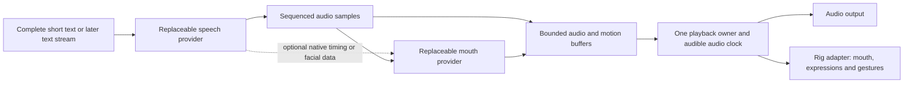

# Speech and lip-sync decision plan — 11 October 2026

## Decision and scope

**Choose and visually validate the mouth-motion path before rewriting speech for streaming.** No engine is selected by this report. Jakub previously tried sound/phoneme-to-mouth dictionaries and found them substantially weaker than Rhubarb. Preserve that result as a quality requirement, rather than assuming that better timestamps will solve it. Kokoro duration mapping stays on the candidate list; it is no longer the recommended default.

Research and documentation only: no model loading, speech generation, audio analysis, installation, weight download, Docker startup or runtime edits. The hardware budget comes from the project's [recorded inventory](dependency-check-2026-10-11.md): Apple M3 with 8 GiB unified memory. Alternative performance figures below are upstream claims, not measurements on this laptop. Existing timing evidence remains in the [earlier report](lip-sync-alternatives-2026-10-11.md).

## How convincing live implementations work

A discrete dictionary supplies a pose for each sound. A richer system can predict overlapping, continuous facial weights from an audio window: jaw opening, lip closure, rounding, stretching and transitions influenced by neighboring sounds. The visual result still depends on training, rig geometry, retargeting and blending. Neither neural inference nor more output channels establishes quality on Asena automatically.

Three useful implementation references:

| Implementation | Actual method and synchronization | What Asena should learn |
| --- | --- | --- |
| Speech Graphics SG Com | CPU audio-stream analysis; vendor describes 50 ms processing delay. Separate Engine and Player buffer and interpolate animation on the input-audio timeline. | Buffer audio until matching movement exists; interpolate by playback position. Support breaths/laughter as performance, not ordinary phonemes. |
| Runtime MetaHuman Lip Sync | Its Realistic models use a compact transformer with mel-spectrogram inputs and continuous facial controls. Docs describe CPU inference, streamed PCM, Mac support and adjustable lookahead for the mood model. | A small neural mouth solver can be a separate component from TTS. The Unreal plugin is an implementation reference, not a browser dependency. |
| LAM-A2E / OpenAvatarChat | Wav2Vec audio features plus style conditioning produce ARKit expression weights. The inspected integration retains inference context and packages audio with 30 fps face data. Its input slicing is **one second**. | Preserve context and pair audio with motion. A system labeled streaming can still buffer a full second before facial output. |

Sources: SG Com's [Engine/Player synchronization](https://docs.speech-graphics.com/en/sg-com/5.1/engines-and-players), [features](https://docs.speech-graphics.com/en/sg-com/5.2/what-is-sg-com) and [Mac Intel/ARM support](https://docs.speech-graphics.com/en/sg-com/5.1/sg-com-platform-support); [Georgy plugin architecture](https://docs.georgy.dev/runtime-metahuman-lip-sync/overview/); [LAM-A2E](https://github.com/aigc3d/LAM_Audio2Expression) and [OpenAvatarChat's actual handler](https://github.com/HumanAIGC-Engineering/OpenAvatarChat/blob/main/src/handlers/avatar/lam/avatar_handler_lam_audio2expression.py).

“Instantaneous” should mean a short, bounded delay with convincing synchronized movement. Compute time, required audio context and buffering are separate quantities. A solver that processes one second of audio in 45 ms has not demonstrated a 45 ms first-frame delay. Fast processing also needs sustained headroom while the LLM, browser and renderer share the machine.

## Rhubarb alternatives: shortlist and obstacles

| Candidate | Output / practical fit | Evaluation priority |
| --- | --- | --- |
| **LAM-A2E through a community ONNX export** | Continuous 52-channel ARKit motion, with CPU/browser deployment candidates. Official setup is CUDA-oriented; community export is the Mac route to verify. | First open neural alternative to investigate, with saved audio and a rig audit. |
| **HeadAudio** | Browser audio-worklet classifier, 15 viseme weights; inexpensive but approximate. | Low-resource comparison, without assuming Rhubarb-level quality. |
| **SG Com** | Commercial local CPU SDK, with Mac ARM support and rig configuration. | Strong practical realism reference; optional evaluation if licensing/access is acceptable. No vendor contact was made. |
| **Runtime MetaHuman Lip Sync Realistic** | CPU neural solver with Mac support, inside Unreal and aimed at MetaHuman/ARKit rigs. | Quality/architecture reference; standalone availability would need verification before an Asena integration. |
| **NeuroSync** | Audio-to-face transformer; current card describes 68 coefficients. Model now resolves to Convai and is gated; linked old Local API returns 404. | Watchlist until a usable maintained runtime, access and Mac resource figures are established. |
| **Audio2Face-3D community Swift/MLX** | Native Apple route exists, but predicts identity-specific geometry coefficients rather than ready VRM shapes. | Later retargeting experiment; current wrapper is not a proven fast streaming replacement. |
| **Kokoro synthesis durations / HeadTTS** | Phone timing from synthesis, followed by sound-to-shape mapping and authored blending. | Retained candidate; Jakub's earlier quality objection applies. |
| **Rhubarb with short batches / native ARM64 / bounded workers** | Preserve the known reference while investigating throughput improvements. | Quality-preserving control; batching alone is insufficient if analysis remains slower than playback. |

### LAM export details worth checking before adoption

The [myned-ai export card](https://huggingface.co/myned-ai/wav2arkit_cpu) claims 30 fps output and roughly 45 ms compute per second of input, without a hardware description sufficient to extrapolate to this M3. Its advertised 1.8 MB size excludes **402 MB of external weights**, visible in the [file inventory](https://huggingface.co/myned-ai/wav2arkit_cpu/tree/main). The export bakes in speaker identity 11; voice/style effects need testing.

Another [community LAM export](https://huggingface.co/adolon-ai/lam-a2e) documents approximately **192 MB** of weights, mixed fp16 precision, WebGPU/WASM variants and a **fixed one-second input**. This is attractive for deployment but implies a buffering/adaptation question. Do not promise sub-100 ms operation, preserve the documented precision behavior, and check output ordering and numerical parity before retargeting. These are different exports, not interchangeable binaries.

[HeadAudio](https://github.com/met4citizen/HeadAudio) uses MFCC/Gaussian classification and documents 50–100 ms processing latency; it is not the same richer transformer approach. Its small prototype model and training examples including `af_heart` make it worth a controlled comparison, not an automatic fallback choice. Simple amplitude/FFT analyzers, Wawa and Unity uLipSync remain lower-cost baselines in the earlier report.

[NeuroSync's current card](https://huggingface.co/convaitech/NEUROSYNC) describes audio-file processing followed by LiveLink playback. That does not establish incremental incoming-audio inference or current M3 performance. Access and conditional licensing also need checking before an experiment.

The [Audio2Face MLX wrapper](https://github.com/soniqo/speech-swift/blob/main/docs/models/audio2face3d.md) documents one coefficient frame per 520 ms window with a 260 ms hop: approximately 3.85 output frames per second under that description. Mark/Claire/James use different geometry bases. Verify this actual temporal contract before treating the port as a realistic live solver; interpolation alone cannot establish adequate articulation. Official NVIDIA deployment and this community Mac port are distinct.

## Local speech generation has moved beyond the old Kokoro choices

Keep Kokoro as the known voice/resource baseline. Evaluate voice naturalness and lip-sync quality separately, using the same text and framing; a new voice does not itself provide mouth motion.

| Local TTS | Why it is worth testing | Streaming and budget qualification |
| --- | --- | --- |
| **Kyutai Pocket TTS** | 100M-class CPU model; voice conditioning and genuine incremental waveform generation. A promising first streaming candidate. | Author reports ~200 ms first chunk and ~6× realtime on M4 with two CPU cores. Neither figure is an M3 measurement. Public API yields audio chunks, without documented native visemes. |
| **Chatterbox Nano**, then Turbo | Nano targets CPU use; both support vocalization tags such as laughter/chuckles. Interesting for a playful companion. | Advertised Nano 110M / Turbo 350M figures are not whole-install sizes. Inspected API returns a complete waveform; low-latency marketing does not establish a streaming API. CPU/MPS loading paths exist, but local performance remains untested. |
| **Qwen3-TTS 0.6B through MLX Audio** | Multilingual voice cloning / preset voices with an Apple-native runtime. | MLX adapter documents chunk yielding. A checked 4-bit Base repository is **1.71 GB**, including supporting assets; not a tiny 300 MB install. No native viseme output established. |
| **Supertonic 3** | ~99M ONNX model, 31 languages, ten expression tags and multiple native/browser runtimes. | **Archived; development/support ended.** Official local voice cloning is absent and Voice Builder was withdrawn. Keep as an isolated speed/expression candidate rather than assume a maintained foundation. |

Pocket sources: [official runtime](https://github.com/kyutai-labs/pocket-tts) and [streaming API](https://kyutai-labs.github.io/pocket-tts/API%20Reference/python-api/). The current API identifies `english_2026-09` as its English default; pin the [configuration and its weight revisions](https://github.com/kyutai-labs/pocket-tts/blob/main/pocket_tts/config/english_2026-09.yaml) when testing. Cloning weights are [gated, CC-BY-4.0](https://huggingface.co/kyutai/pocket-tts); an official [non-cloning model](https://huggingface.co/kyutai/pocket-tts-without-voice-cloning) is available. Use stock voices for an initial comparison. Voice assets have their own licenses.

Chatterbox sources: [official model family](https://github.com/resemble-ai/chatterbox), [Nano card](https://huggingface.co/ResembleAI/chatterbox-nano), and [actual Turbo/Nano generation implementation](https://github.com/resemble-ai/chatterbox/blob/master/src/chatterbox/tts_turbo.py). The [Nano repository](https://huggingface.co/ResembleAI/chatterbox-nano/tree/main) totals about **3 GB**, including two ~1.06 GB decoder files and an ~870 MB T3 checkpoint. The inspected loader fetches all safetensors, although generation selects the meanflow decoder. Plan a filtered download only after verifying compatibility. Nano's claimed 3× realtime on eight CPU cores is not evidence for our two-core budget. Tags are supported; the original model's CFG/exaggeration knobs are explicitly ignored by Turbo/Nano.

Qwen sources: [official model capability table](https://github.com/QwenLM/Qwen3-TTS), [MLX streaming adapter](https://github.com/Blaizzy/mlx-audio/blob/main/mlx_audio/tts/models/qwen3_tts/README.md) and [4-bit Base files](https://huggingface.co/mlx-community/Qwen3-TTS-12Hz-0.6B-Base-4bit/tree/main). The official table marks instruction control for the **1.7B** VoiceDesign/CustomVoice models, not 0.6B. Some adapter descriptions imply more; use official capabilities until verified. Treat 1.7B as a later isolated expressiveness experiment, not the default with a resident LLM on 8 GiB.

Supertonic source: [archived official project](https://github.com/supertone-oss-archive/supertonic). Code is MIT; weights use OpenRAIL-M. ONNX examples and sentence delivery do not establish incremental waveform generation or phone alignment. Verify the selected runtime's actual contract.

**Recommendation for later authorized local tests:** Pocket for true CPU streaming, Nano for vocal expression, then quantized Qwen 0.6B if the combined budget allows. Test one resident TTS at a time. Native Kokoro remains a useful separate control for removing Docker overhead; native acceleration is not an assumed speedup. File size, active RAM and the memory shared with GPU rendering are different budgets.

## Cloud experiments remain secondary

**Azure neural speech with 3D blend shapes** is especially useful as a synchronized reference: documented output includes grouped frames with **55 facial values at 60 fps**, accompanied by speech events. Availability depends on voice/locale and SSML output selection. This supplies more than word times; it still requires mapping to Asena's actual rig. [Official viseme/blend-shape contract](https://learn.microsoft.com/en-us/azure/ai-services/speech-service/how-to-speech-synthesis-viseme).

**ElevenLabs** offers a separate expressive voice comparison. Its current docs list **Eleven v4** and **v4 Turbo**, alongside v3; v4 Turbo uses the Text-to-Dialogue WebSocket path. Published latency excludes network/application overhead. This is a candidate quality ceiling, not an independently established winner. The [speech timing endpoint](https://elevenlabs.io/docs/api-reference/text-to-speech/stream-with-timestamps) returns character alignment, not visemes or facial weights, so pair it with the same evaluated mouth solver. Verify metadata support for the chosen model/endpoint rather than assuming every API has the same contract. [Current model capabilities](https://elevenlabs.io/docs/overview/models).

No account setup, paid calls or cloud audio submissions were made. These experiments should clarify what vocal performance is missing locally, without becoming prerequisites for the local architecture.

## Proposed audio/mouth contract before TODOs 12–14

This is a design proposal, not an implemented protocol:

1. **Speech boundary:** turn ID, sequence, sample rate/channels, start-sample index and PCM block length. Include normalized spoken text and optional provider-native alignment; distinguish end, error and cancellation. Decode any compressed source once and align all timing to the decoded samples. Resampling must preserve time offsets. Text chunks, audio blocks and facial-analysis windows need not have equal sizes.
2. **Mouth boundary:** timestamped named weights or explicitly typed viseme cues, plus the audio interval they cover and a readiness watermark. No ambiguous shared A/B/C alphabet. Retain source metadata for inspection. Rich coefficients need a rig-specific adapter, not a blind substitution for four vowel channels.
3. **Readiness:** start only once audio and corresponding mouth data cover the initial playback window, including the solver's required lookahead. Preserve model state or overlapped context across windows. Choose a measured startup buffer per engine; do not commit to 100 ms for a fixed one-second model.
4. **Playback:** one bounded PCM player, preferably an AudioWorklet, owns consumed sample position. Facial/body sampling follows the audible position, compensating for output-device latency where measurable. Network arrival time and inference completion time never become the animation clock. Do not let silence inserted for an underrun advance speech events.
5. **Pause, stop and late output:** freeze performance position on pause; apply backpressure or stop production before buffers exceed limits. Cancellation clears audio, face data and model context for that turn; reject late blocks. Do not reset the face at every chunk boundary. Interpolate overlapping controls and preserve body ownership.
6. **Failure:** distinguish missing motion from missing audio. A short bounded hold can await motion; after its deadline, show a visible failure/selected fallback. Preserve Rhubarb batch mode. Do not silently downgrade to a dictionary that the user already found unsatisfactory. Agree fallback behavior during mode selection.

TODO 11 already provides ownership and an audio clock for **complete finite-duration HTMLAudio segments**. It does not accept ongoing PCM or arbitrary continuous facial-weight frames. Preserve its cancellation/queue rules while adding a tested transport/player adapter; do not claim streaming is already solved by enqueueing raw chunks. Existing sequential audio elements may have boundary gaps.

## Evaluation gates and implementation order

- [ ] **Rig and reference gate:** inspect all actual avatar mouth morphs; introduce source-specific canonical adapters for the already recorded Rhubarb/dictionary mismatch. Preserve original cue fixtures. Establish a visually accepted Rhubarb reference. Keep happy blending's separate TODO 20a visible; fixing the adapter must not erase Jakub's earlier dictionary-quality experience.
- [ ] **Mouth-quality gate, before TTS changes:** compare saved WAVs through Rhubarb, HeadAudio and one practical LAM export, selectable in the same replay scene. Initial comparison uses neutral expressions. Retargeting has to demonstrate closure, opening and rounding before judging a richer solver. This experiment still needs explicit preparation for loading a neural alternative.
- [ ] **Streaming-feasibility gate:** measure required context, first matching frame, throughput, CPU, peak RAM and jitter; simulate incremental arrival of saved audio. Record output-frame rate and seam behavior. Test pause, starvation, cancellation and stale output. A fast whole-file batch is insufficient proof.
- [ ] **Voice gate:** separately compare a short greeting, teasing, gentle disagreement, numbers/names and one laugh/sigh using the chosen local TTS candidates. Measure native process memory and first chunk; account for eventual LM/browser concurrency. Cloud samples are optional later references.
- [ ] **Selection gate:** Jakub chooses quality/latency/resource tradeoffs from comparable recordings. Target at least the accepted Rhubarb mouth quality, with no accumulating drift or pauses at every word. Record the selected engine, rig adapter, window/hop, startup buffer and fallback before starting the streaming rewrite.
- [ ] **Transport and integration gate:** implement TODO 12 framing/player and TODO 13 bounded text delivery using the agreed contract; integrate TODO 14's selected solver. Use saved/synthetic data for transport tests before a short authorized live benchmark under TODO 16.

The next useful implementation is the controlled lip-sync comparison on existing recordings. The research does not yet justify replacing TTS, adopting a particular neural solver, or marking generation TODOs complete.
