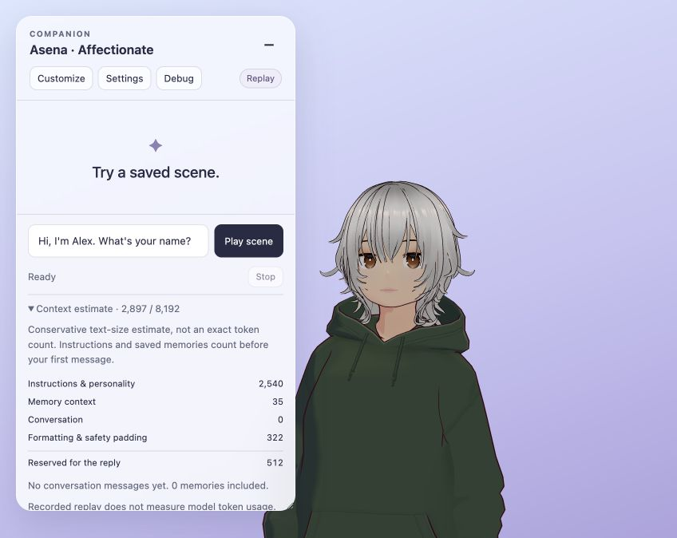
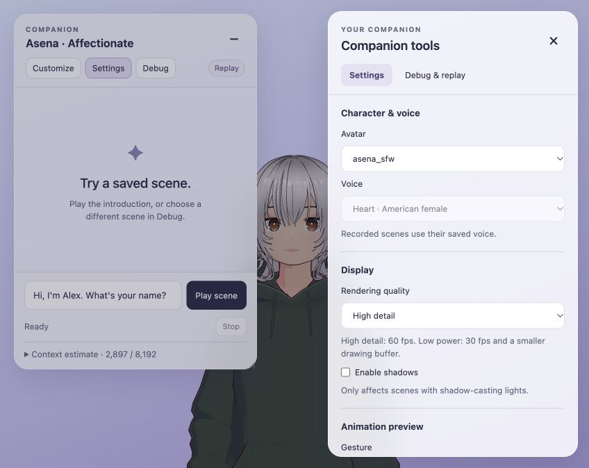
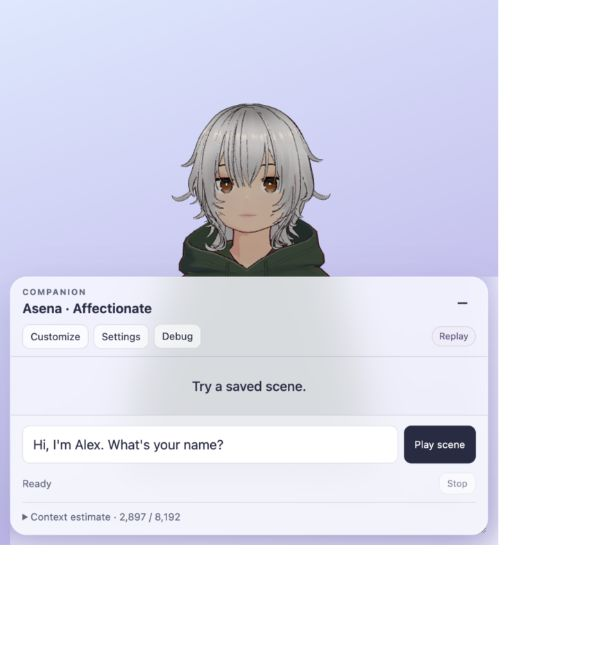
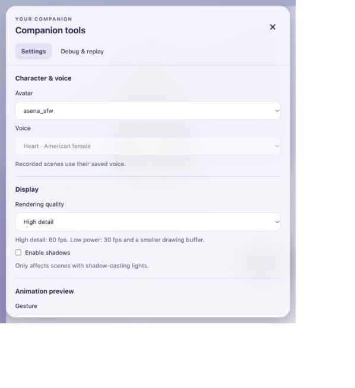

# TODO 10a — UI cleanup

Implemented and accepted by Jakub on 11 October 2026. Jakub selected **draggable chat with Settings and Debug in one switchable side panel**, retaining the lavender/glass appearance. TODO 10a is complete.

## What changed

- Chat has a draggable header, Hide/Open controls, a compact toolbar, messages in chronological order with author labels, and a dedicated composer/status area. Dragging and resizing stay within the viewport and leave room for the tools panel on wide screens.
- Settings are grouped into character/voice, display, animation preview and memory. Voice and gesture labels are readable; gesture values still use the existing animation keys. Loading, unavailable controls and memory-save failures have local explanations.
- Settings and Debug occupy the same panel. Replay controls and the collapsible JSON inspector live under Debug; only the selected view is shown. Detailed inspection refreshes while that view and its disclosure are open.
- The context meter expands into an explanation and component counts. It clearly labels the conservative estimate and separately displays measured usage when a live backend supplies it.
- The customizer uses consistent controls and spacing. Its existing personality, closeness, relationship and preference fields remain wired into the next prompt.
- Narrow screens use a tools drawer with a backdrop, focus containment and Escape dismissal. Chat leaves space above it for the avatar's face. Keyboard shortcuts avoid text fields; panel tabs support arrow keys/Home/End and closing returns focus to the opening control.
- System fonts, consistent focus styles and larger readable controls replace the old scattered styling. High detail remains the default rendering quality. Text remains gated until startup settles.

## Why the empty conversation still shows 2,897

The empty recorded benchmark currently displays:

| Component | Conservative input estimate |
| --- | ---: |
| Instructions and personality | 2,540 |
| Memory context, including its header | 35 |
| Conversation | 0 |
| Formatting and safety padding | 322 |
| Total | 2,897 |

Another 512 units are reserved for the reply, separately from that input total. Zero stored facts can still leave the memory header. These are conservative UTF-8 text-size bounds, not tokenizer measurements. Replay does not measure real model usage. The packing/trimming algorithm was unchanged; the added fields explain the existing budget.

## Verification

All **58 automated checks pass: 39 JavaScript and 19 Python**. A new budget regression verifies that the component breakdown sums to the packed input, including Unicode and omitted history. Source syntax and diff checks pass.

Browser checks covered recorded introduction playback, chronological messages, speaking-to-finished status, idle return, tab switching, JSON expansion/collapse, customization opening, dragging, hide/restore, rendering controls and startup gating. Narrow-screen checks covered viewport bounds, visible avatar face, drawer modality, focus wrapping and Escape dismissal. A temporary mock live server with missing avatar/data verified visible failures, disabled unsafe memory saving and retained text replies. It supplied synthetic replies and did not contact AI services.

No LLM, Kokoro, Docker workload or Rhubarb process was started. The temporary fixture server and agent test tabs were closed; the existing replay website remains available on port 3001. Automated checks and these browser exercises do not establish natural animation or live-model quality.

## Manual review for Jakub

- Refresh the website and assess chat placement, readability and avatar visibility at your usual window size.
- Drag, resize and hide/restore chat; switch Settings/Debug and check that controls remain accessible.
- Expand the context meter before and after a scene and inspect the conversation count.
- Open Customize and check that your familiar settings are easy to find.
- Preview gestures, play the introduction, then inspect and collapse larger JSON branches.
- Check the drawer and chat on a narrow window or phone layout.

Jakub accepted this review on 11 October 2026 after refinements to dropdown arrow spacing, glass transparency and scrollbar visibility. Scrollbars are hidden throughout the UI; scrolling remains available. The screenshots above show the initial implementation before those refinements.
